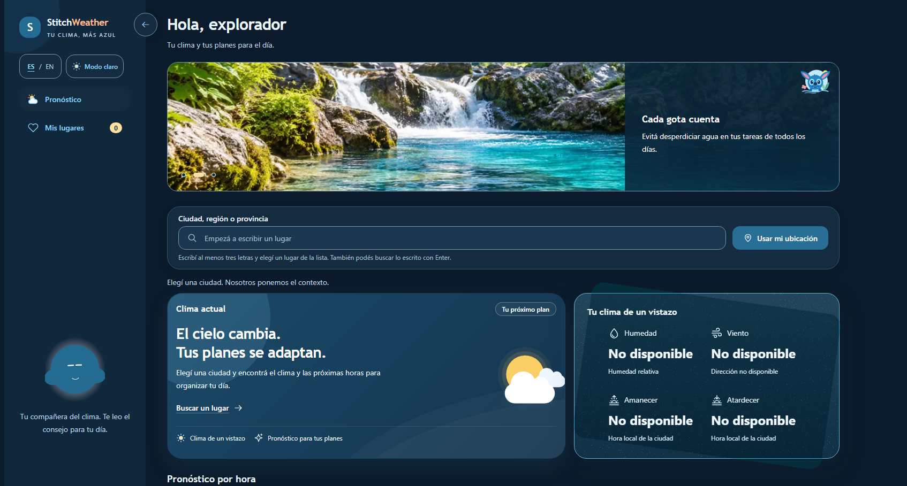

# StitchWeather

Frontend de la app del clima, desarrollado con Angular 21 y Tailwind CSS. Permite buscar lugares o usar la ubicación actual, consultar el clima y pronóstico, y recibir recomendaciones de IA en español o inglés.

Consume la API de [app-clima-backend](https://github.com/aubarcito48/app-clima-backend). Las claves de los proveedores se configuran únicamente en el backend.

**Publicado en Vercel:** [https://app-clima-ecru.vercel.app/](https://app-clima-ecru.vercel.app/)

[](https://app-clima-ecru.vercel.app/)

## Ejecución local

Requiere Node.js 24 y npm. Desde esta carpeta, en PowerShell:

```powershell
npm ci
Copy-Item .env.example .env
npm start
```

Si ya existe `.env`, conservá el archivo. La aplicación abre en `http://localhost:4200` y espera el backend en `http://localhost:8000`.

Para cambiar la API, ajustá `PUBLIC_API_BASE_URL_DEVELOPMENT` o `PUBLIC_API_BASE_URL_PRODUCTION` en `.env` y reiniciá o recompilá. La URL de producción de la plantilla es un marcador: reemplazala antes de publicar.

## Isabel (Isa)

Isa usa el avatar del ZIP elegido en Bible Strong Avatar Lab. Se carga localmente
con `@bible-strong/avatar-core`, sin consultar un CDN. Su diseño original se conserva.

Isa arranca con la voz activada y permanece en silencio hasta recibir el consejo
de Groq de una consulta en español una sola vez. Podés silenciarla
tocando el avatar de Isa. Otro toque activa la voz. La elección dura durante la sesión y vuelve a estar
activada al recargar. El backend genera el audio con Piper y la voz femenina
Sharvard (`F = 1`), en español de España. Requiere instalar `requirements-voice.txt`
y el modelo en el backend; los pasos están en su README. No requiere una API key adicional.
En producción hay que instalar el motor y modelos también en el servidor.
El audio es WAV PCM16 mono a 22.050 Hz; el frontend lee su frecuencia para
sincronizar la boca. La voz funciona en el despliegue gratuito de Render.

Al cambiar de búsqueda o idioma se cancela la lectura anterior. Si el navegador
bloquea la reproducción, se informa el motivo y el consejo queda disponible como texto.
Si falla la voz, el texto del clima continúa disponible. Las animaciones responden
al estado del audio y al contenido de las frases automáticamente, respetando movimiento reducido.

## Comandos

```powershell
npm run build                 # Compilación de producción
npm test -- --watch=false     # Pruebas unitarias
npm run e2e:install           # Instalar Chromium (primera vez)
npm run e2e                  # Pruebas de extremo a extremo
```
