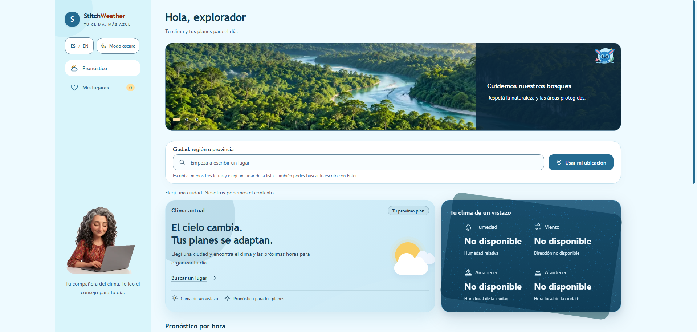

# StitchWeather

Consultá el clima y el pronóstico de una ciudad, y recibí recomendaciones con IA
en español o inglés. Isa acompaña las recomendaciones con voz y un avatar animado.

**[Probar StitchWeather](https://app-clima-ecru.vercel.app/)** ·
[Backend del proyecto](https://github.com/aubarcito48/app-clima-backend)

[](https://app-clima-ecru.vercel.app/)

## Versiones de la aplicación

StitchWeather está disponible en **Angular, Vue y React**. Cada implementación
tiene su propia rama y conserva las funcionalidades de la app: consultas del
clima, pronóstico, favoritos, idiomas, temas, mapa, alertas y la voz de Isa.
Las tres versiones comparten el mismo backend Django.

| Frontend | Rama | Instalación y ejecución |
| --- | --- | --- |
| Angular | [`main`](https://github.com/aubarcito48/app-clima/tree/main) | [README de Angular](https://github.com/aubarcito48/app-clima/blob/main/README.md) |
| Vue | [`vuejs`](https://github.com/aubarcito48/app-clima/tree/vuejs) | [README de Vue](https://github.com/aubarcito48/app-clima/blob/vuejs/README.md) |
| React | [`reactjs`](https://github.com/aubarcito48/app-clima/tree/reactjs) | [README de React](https://github.com/aubarcito48/app-clima/blob/reactjs/README.md) |

La demo enlazada arriba y las instrucciones de este README corresponden a
Angular (`main`). Para ejecutar Vue o React, elegí su rama y seguí su README.

## Funcionalidades

- Búsqueda de ciudades y consulta de la ubicación actual con permiso del navegador.
- Clima actual, pronóstico y unidades Celsius o Fahrenheit.
- Recomendaciones generadas con Groq y lectura con la voz de Isa.
- Interfaz en español e inglés, con tema claro y oscuro.
- Mapa meteorológico, alertas y contactos de emergencia según el país consultado.

El frontend utiliza Angular, TypeScript, Tailwind CSS y Leaflet. El backend Django
consulta los proveedores meteorológicos y Groq, y genera la voz con Piper.
Las claves de los proveedores permanecen exclusivamente en el backend.

| Tecnología | Para qué se usa |
| --- | --- |
| Angular y TypeScript | Interfaz, componentes y estado de la aplicación. |
| Tailwind CSS y CSS | Diseño adaptable y temas visuales. |
| Leaflet | Visualización del mapa. |
| Django y OpenWeather | API y datos meteorológicos. |
| Groq | Recomendaciones con IA. |
| Piper y sincronización propia | Voz de Isa en español e inglés y movimientos de boca. |

## Antes de instalar

Para usar la aplicación publicada alcanza con abrir la demo; no necesitás
instalar herramientas ni tener claves propias.

Para ejecutarla en tu PC necesitás **Git, Node.js 24, npm y el backend Django**.
El backend necesita Python 3.14, claves propias de OpenWeather y Groq y los
modelos de voz si querés escuchar a Isa. La primera instalación necesita internet
y espacio adicional para dependencias y modelos.

Prepará primero el backend siguiendo su
[guía completa de instalación](https://github.com/aubarcito48/app-clima-backend#instalación-desde-cero).
No requiere migraciones ni PostgreSQL. Dejalo ejecutándose y abrí una segunda
terminal para el frontend.

## Ejecutar el frontend

Descargá el frontend en una carpeta distinta del backend:

```powershell
git clone https://github.com/aubarcito48/app-clima.git
cd app-clima
node --version
npm --version
```

Instalá las dependencias desde esa carpeta:

```powershell
npm ci
```

Si todavía no tenés un archivo `.env`, crealo a partir del ejemplo:

```powershell
Copy-Item .env.example .env
```

Conservá tu `.env` si ya existe. Configurá `PUBLIC_API_BASE_URL_DEVELOPMENT` con
la dirección de tu backend; el valor de ejemplo es `http://localhost:8000`.
Usá el origen sin añadir `/api/v1`. Estas variables son públicas: nunca pongas
claves de OpenWeather o Groq en el frontend.

```powershell
npm start
```

Abrí `http://localhost:4200`. El backend debe estar ejecutándose para consultar
el clima, generar recomendaciones y reproducir la voz. `npm start` prepara la
configuración pública del frontend automáticamente.

### Comprobar que funciona

1. Abrí `http://localhost:8000/api/v1/health/`: debe responder `{"estado":"ok"}`.
   Eso solo confirma que la API está activa.
2. Abrí `http://localhost:4200` y buscá una ciudad.
3. Comprobá los datos meteorológicos y la recomendación; hacé clic sobre Isa si
   el navegador bloquea el audio automático.
4. Cambiá a inglés y probá otra consulta para verificar ambos idiomas.

Para volver a iniciar el proyecto otro día, abrí dos terminales: ejecutá
`manage.py runserver` con el Python del entorno del backend en una, y `npm start`
desde la carpeta del frontend en la otra. No reinstales dependencias y modelos
en cada inicio; repetí la instalación cuando cambien los requisitos.

## Compilación y pruebas

```powershell
npm run build
```

Antes de publicar esa compilación, configurá `PUBLIC_API_BASE_URL_PRODUCTION`
con el origen HTTPS de tu backend y permití el origen del frontend en CORS.
El dominio `api-clima.example.invalid` del ejemplo es un marcador, no un servidor.

Las pruebas se ejecutan aparte y levantan una instancia local aislada:

```powershell
npm run e2e:install
npm run e2e
```

Las pruebas de navegador con Playwright se conservan en `e2e/`. Para ver el
informe generado, ejecutá `npm run e2e:report`.
Son pruebas del comportamiento de la aplicación, no una certificación de todos
los navegadores ni una comprobación permanente de proveedores externos.

## Organización

Los archivos se agrupan por funcionalidad dentro de cada capa: páginas en
`src/app/pages/`, servicios en `src/app/service/`, modelos en `src/app/models/`
y componentes compartidos en `src/app/shared/`.

## Voz y disponibilidad

Si el navegador bloquea la reproducción automática, hacé clic sobre Isa para
escuchar la recomendación. El texto también queda disponible para leerlo.
El tiempo de respuesta depende de los proveedores y del servidor que genera
la voz; puede aumentar cuando el servicio está iniciándose.

## Navegadores y permisos

La aplicación está pensada para navegadores modernos con JavaScript habilitado.
El alcance de las comprobaciones actuales es el siguiente:

| Navegador o motor | Estado de comprobación |
| --- | --- |
| Chromium de Playwright | La suite configurada incluye tamaños de celular, tablet y escritorio. |
| Google Chrome y Microsoft Edge | Comparten el motor Chromium; la suite no equivale a verificar cada versión comercial o dispositivo. |
| Safari y Firefox | Pendiente una validación completa propia; no se garantiza paridad de todas las funciones. |

En Safari y en otros navegadores, el audio automático puede bloquearse: hacé clic
o tocá a Isa para iniciar la reproducción cuando esté disponible. Una interacción
del usuario puede ser necesaria incluso si el audio se inicia mediante JavaScript.
Referencia: [políticas de reproducción de audio en MDN](https://developer.mozilla.org/en-US/docs/Web/API/HTMLMediaElement/play).

La ubicación actual requiere permiso del navegador y un contexto seguro
(HTTPS en un sitio publicado o localhost durante el desarrollo). Si rechazás el
permiso, podés seguir buscando ciudades manualmente. La voz de Isa no requiere
acceso al micrófono del visitante.

## Problemas frecuentes

| Problema | Qué revisar |
| --- | --- |
| No encuentra `npm` o `node` | Instalá Node.js 24 y abrí una terminal nueva. |
| Abre la interfaz pero no carga el clima | Comprobá que Django esté activo, la URL del backend y sus claves. |
| Error de CORS | El origen exacto del frontend debe figurar en `CORS_ALLOWED_ORIGINS` del backend. |
| El audio no empieza | Esperá la generación, tocá a Isa y revisá volumen y permisos de reproducción. Si falla la generación, revisá las voces del backend. |
| La ubicación no funciona | Revisá permisos y HTTPS; podés escribir la ciudad igualmente. |
| Cambiaste el `.env` y no se refleja | Reiniciá `npm start`; si editaste el `.env` del backend, reiniciá Django. |
| El puerto 4200 está ocupado | Iniciá con `npm start -- --port 4201` y agregá ese origen al CORS del backend. |

## Compartir comentarios

Podés [abrir un issue](https://github.com/aubarcito48/app-clima/issues) con una
sugerencia o un error. Para ayudar a reproducirlo, indicá el navegador, el
dispositivo, los pasos y una captura sin datos privados.


## Ejecutar con Docker

Esta opci?n practica una imagen independiente del frontend. Necesit?s Docker
Desktop con contenedores Linux (o Docker Engine en Linux); no necesit?s instalar
Node.js en el equipo. El backend se construye y ejecuta desde su propio repositorio.

Desde la ra?z de este repositorio:

```powershell
docker build -t stitchweather-frontend:local .
docker run -d --name stitchweather-frontend -p 127.0.0.1:8080:80 stitchweather-frontend:local
```

Abr? `http://localhost:8080`. La imagen usa por defecto la API en
`http://localhost:8000`; levant? el contenedor del backend siguiendo su README.
Su `CORS_ALLOWED_ORIGINS` debe incluir `http://localhost:8080`. Si abr?s el frontend
con `127.0.0.1`, permit? tambi?n ese origen exacto.

El Dockerfile tiene dos etapas: Node 24 ejecuta `npm ci` y compila Angular;
la imagen final contiene Nginx y los archivos compilados. Nginx conserva las
rutas de Angular al recargar y ofrece `/healthz` para el healthcheck. Los `.env`
locales, dependencias y resultados de pruebas quedan fuera del contexto.

### Elegir otra API o preparar un futuro servidor

```powershell
docker build --build-arg PUBLIC_API_BASE_URL_PRODUCTION=https://api.tu-dominio.com -t stitchweather-frontend:server .
```

Us? el origen sin `/api/v1`. Esta direcci?n la utiliza **el navegador del
visitante**: `localhost` sirve para una pr?ctica en tu PC, pero en un servidor
remoto necesit?s la URL p?blica HTTPS de la API. HTTP se admite ?nicamente en
loopback (`localhost`, `127.0.0.1` o `[::1]`). No uses un nombre interno de Docker.

La URL se incorpora **al construir** la imagen. Cambiarla con `docker run -e`
no modifica el JavaScript: constru? otra imagen si cambi?s de API. Nunca pases
claves de OpenWeather o Groq como argumentos de construcci?n del frontend.
Para publicar en un servidor tambi?n hay que configurar el dominio y HTTPS
mediante el proxy del alojamiento.

### Verificar y detener

```powershell
docker ps --filter name=stitchweather-frontend
docker logs stitchweather-frontend
docker stop stitchweather-frontend
docker rm stitchweather-frontend
```

La columna STATUS muestra `healthy` cuando pasa el control HTTP. `stop` detiene
el contenedor; `rm` permite volver a crearlo con otra imagen o configuraci?n.
Pod?s comprobar la validaci?n de URLs con `npm run test:env` si ten?s Node.js.
