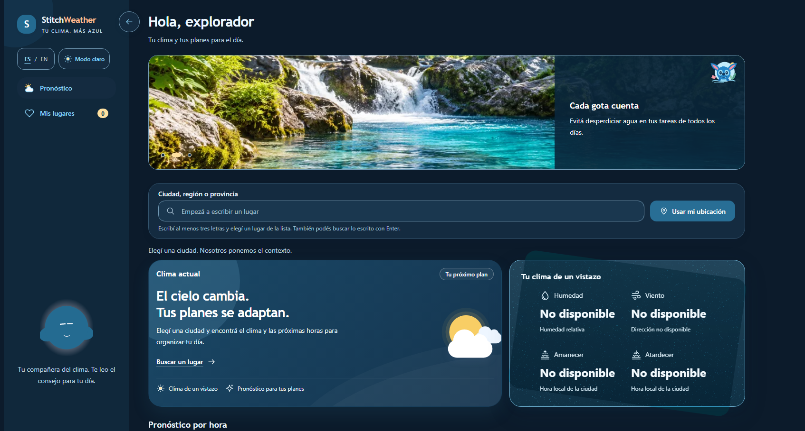

# StitchWeather

Frontend de la app del clima, desarrollado con Angular 21 y Tailwind CSS. Permite buscar lugares o usar la ubicación actual, consultar el clima y pronóstico, y recibir recomendaciones de IA en español o inglés.

Consume la API de [app-clima-backend](https://github.com/aubarcito48/app-clima-backend). Las claves de los proveedores se configuran únicamente en el backend.

**Publicado en Vercel:** [https://app-clima-ecru.vercel.app/](https://app-clima-ecru.vercel.app/)

[](https://app-clima-ecru.vercel.app/)

## Ejecución local

Requiere Node.js 24 y npm. Desde esta carpeta, en PowerShell:

```powershell
npm ci
Copy-Item .env.example .env
npm start
```

Si ya existe `.env`, conservá el archivo. La aplicación abre en `http://localhost:4200` y espera el backend en `http://localhost:8000`.

Para cambiar la API, ajustá `PUBLIC_API_BASE_URL_DEVELOPMENT` o `PUBLIC_API_BASE_URL_PRODUCTION` en `.env` y reiniciá o recompilá. La URL de producción de la plantilla es un marcador: reemplazala antes de publicar.

## Isabel (Isa)

Isa usa un personaje ilustrado inspirado en la referencia aportada por el usuario.
Se dibuja en canvas con 61 cuadros seleccionados del video original y 204 cuadros
del nuevo video de habla, preparados en WebP. Conserva reposo, despertar, mirada a la derecha en escritorio,
mirada hacia abajo en móvil y regreso al frente al hablar. No sigue el cursor.
Los originales permanecen en `public/isa-bot`, excluidos de los assets publicados;
la app solo carga `public/isa-bot/runtime`. El detalle del proceso está en
[`src/app/shared/isabel/README.md`](src/app/shared/isabel/README.md).

Isa arranca con la voz activada y permanece en silencio hasta recibir el consejo
de Groq de una consulta en español o inglés una sola vez. Podés silenciarla
tocando el avatar de Isa. Otro toque activa la voz. La elección dura durante la sesión y vuelve a estar
activada al recargar. El backend genera el audio con Piper y la voz femenina
Sharvard (`F = 1`) en español de España y Lessac en inglés de Estados Unidos.
El idioma de la página selecciona la voz; silenciarla funciona en ambos idiomas.
Requiere instalar `requirements-voice.txt`
y el modelo en el backend; los pasos están en su README. No requiere una API key adicional.
En producción hay que instalar el motor y modelos también en el servidor.
El audio es WAV PCM16 mono a 22.050 Hz; el frontend lee su frecuencia para
sincronizar la boca. La voz funciona en el despliegue gratuito de Render.

Al cambiar de búsqueda o idioma se cancela la lectura anterior. Si el navegador
bloquea la reproducción, se informa el motivo y el consejo queda disponible como texto.
Si falla la voz, el texto del clima continúa disponible. Las poses responden
al estado de la consulta y del audio, respetando movimiento reducido. El habla usa
cuadros completos del nuevo video: mantiene la continuidad entre sílabas y busca
una boca cerrada dentro del mismo tramo para las pausas largas. Solo cambia al
retrato de reposo al terminar; no es sincronización por fonemas.

## Comandos

El despliegue en Vercel utiliza las cabeceras de `vercel.json`: bloqueo de embedding,
nosniff, permisos de ubicación limitados al propio origen y CSP para base, objetos
y ancestros. No es una CSP completa para scripts. Las pruebas `e2e/security.spec.ts`
verifican que el contenido externo se muestra como texto y no ejecuta HTML.
El backend aplica presupuestos de solicitudes en producción; ver su informe
[de seguridad](https://github.com/aubarcito48/app-clima-backend/blob/main/SECURITY_REVIEW.md).

```powershell
npm run build                 # Compilación de producción
npm test -- --watch=false     # Pruebas unitarias
npm run e2e:install           # Instalar Chromium (primera vez)
npm run e2e                  # Pruebas de extremo a extremo
```
